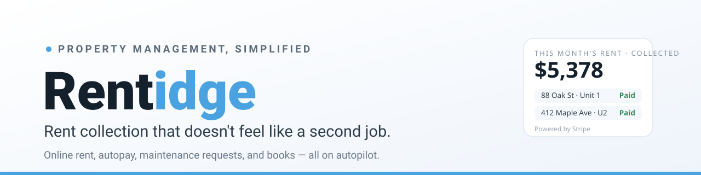
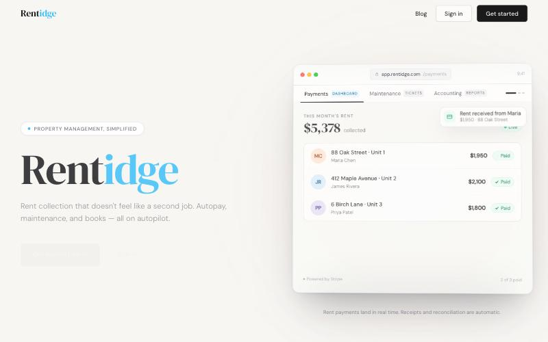

  

<h1 align="center">Rentidge</h1>

<strong>Modern property management &amp; rent payments.</strong>

<a href="https://nest-pay-theta.vercel.app"><strong>Live app ↗</strong></a>

---

**Rentidge** is a rental-property platform that makes rent collection effortless.
Landlords track payments across every unit; tenants pay online with autopay,
receipts, and maintenance requests — and the books reconcile themselves.

  

## For landlords

- Track rent across all units from one dashboard
- Automatic receipts and reconciliation
- E-signed leases and documents

## For tenants

- Pay rent online securely, with saved-card autopay
- Submit and track maintenance requests
- Full payment history

## Built with

- **Next.js** + TypeScript, deployed on **Vercel**
- **Stripe** for payments
- **Supabase** (Postgres + auth) for data
- **Dropbox Sign** for e-signatures · **Resend** for email · **Upstash** for rate limiting
